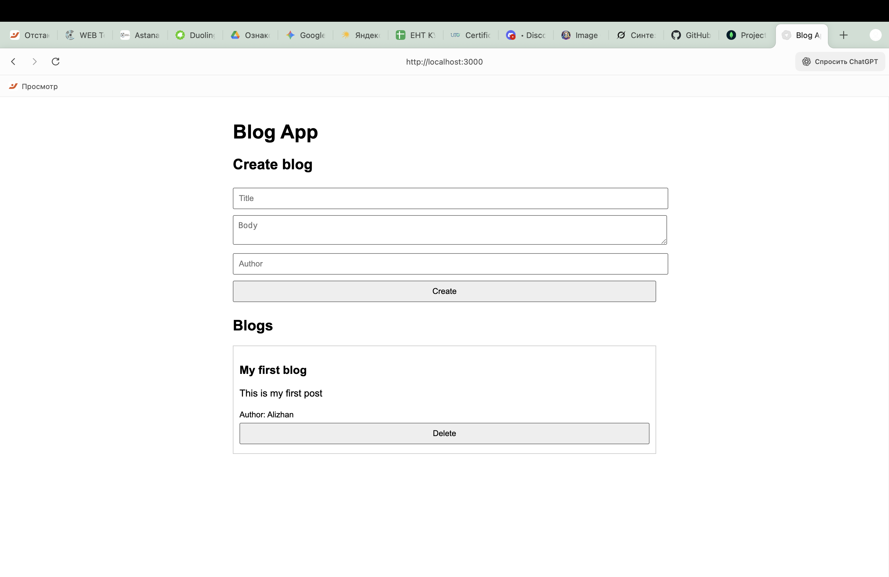
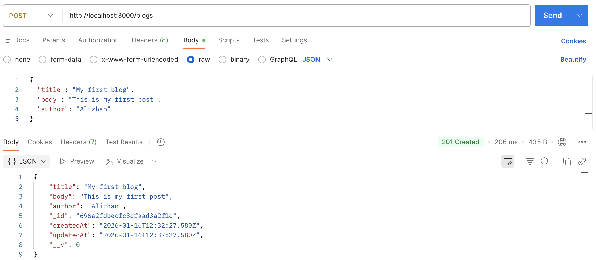
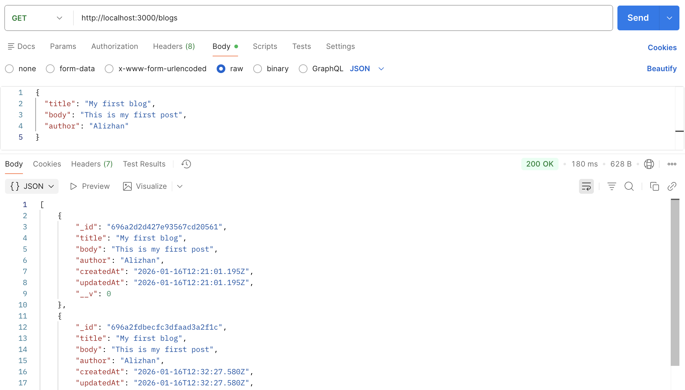

# CRUD Blog API

A simple RESTful API for managing blog posts, built with **Node.js**, **Express**, and **MongoDB**. It includes a basic **HTML/JS frontend** for interacting with the API.

## Features
* **CRUD Operations:** Create, Read, Update, and Delete blog posts.
* **REST API:** JSON-based endpoints.
* **Frontend:** Simple interface to create and list blogs.

## Tech Stack
* **Runtime:** Node.js
* **Framework:** Express.js
* **Database:** MongoDB & Mongoose
* **Frontend:** HTML5, CSS, Vanilla JS (Fetch API)

## Screenshots

### Frontend Interface


### API: Create Blog (POST)


### API: Get All Blogs (GET)


## Installation & Setup

1.  **Clone the repository:**
    ```bash
    git clone [https://github.com/alizhan-t/crud-blog-api.git](https://github.com/alizhan-t/crud-blog-api.git)
    cd crud-blog-api
    ```

2.  **Install dependencies:**
    ```bash
    npm install
    ```

3.  **Environment Configuration:**
    Create a `.env` file in the root directory and add your MongoDB connection string:
    ```env
    PORT=3000
    MONGO_URI=your_mongodb_connection_string
    ```

4.  **Run the application:**
    * Development (auto-reload):
        ```bash
        npm run dev
        ```
    * Start server:
        ```bash
        npm start
        ```

5.  **Open in Browser:**
    Go to `http://localhost:3000` to use the frontend.

## API Endpoints

| Method | Endpoint | Description |
| :--- | :--- | :--- |
| **GET** | `/blogs` | Retrieve all blog posts |
| **GET** | `/blogs/:id` | Retrieve a single post by ID |
| **POST** | `/blogs` | Create a new post |
| **PUT** | `/blogs/:id` | Update an existing post |
| **DELETE** | `/blogs/:id` | Delete a post |

## Project Structure

```text
src/
 ├── controllers/    # Route logic (create, read, etc.)
 ├── models/         # Mongoose schema (Blog.js)
 ├── routes/         # API route definitions
 ├── app.js          # Express app configuration
 └── server.js       # Server entry point
public/              # Static frontend files (index.html)
screenshots/         # Project screenshots