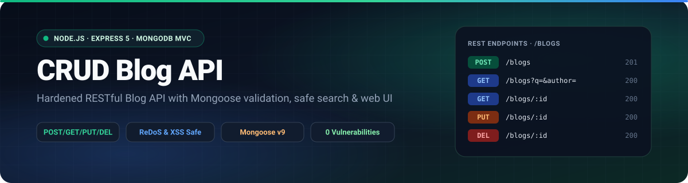
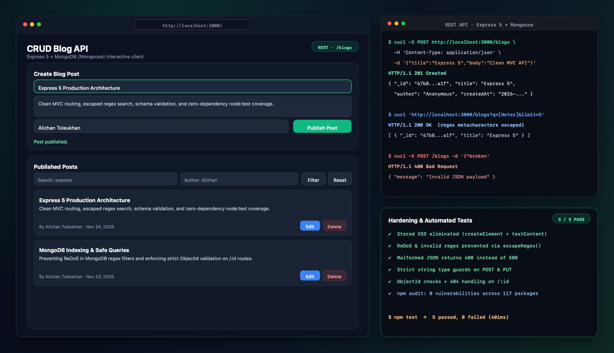
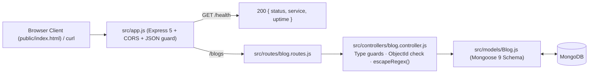

<div align="center">



<br /><br />

[](https://nodejs.org/)
[](https://expressjs.com/)
[](https://mongoosejs.com/)
[](tests/blog.test.js)
[](LICENSE)

**Hardened MVC RESTful Blog API built with Node.js, Express 5, and MongoDB (Mongoose 9) — featuring schema validation, ReDoS-safe search & filtering, centralized JSON error handling, an XSS-safe browser client, and native `node:test` coverage.**

[Features](#key-features) · [Architecture](#architecture) · [API Reference](#api-reference) · [Quick Start](#quick-start) · [Testing](#testing)

</div>

---

<p align="center">
  
</p>

## Key Features

- **Clean MVC Architecture:** Separated routes (`src/routes/`), injectable controller (`src/controllers/`), Mongoose schema (`src/models/`), Express app factory (`src/app.js`), and graceful shutdown entry point (`src/server.js`).
- **Full CRUD + Filtering:** Supports `POST`, `GET` (with `?q=`, `?author=`, `?limit=`), `GET /:id`, `PUT /:id`, and `DELETE /:id` alongside `/health`.
- **Security & Validation Hardening:**
  - **ReDoS-safe search:** Escapes regex metacharacters (`escapeRegex()`) before building MongoDB search queries.
  - **Strict type & ObjectId checks:** Rejects non-string payloads, empty fields, invalid `ObjectId`s, and malformed JSON bodies with clean `400` responses (never raw `500`s).
  - **XSS-safe browser client:** `public/index.html` renders all posts via `createElement` + `textContent` with full create, edit, delete, search, and author filter controls.
- **Zero-Dependency Tests & Clean Audit:** 5 unit + Express HTTP integration tests using Node's built-in `node:test` (`npm test`, **0 npm vulnerabilities**).

---

## Architecture



---

## API Reference

| Method | Endpoint | Query / Body | Status Codes | Description |
| :--- | :--- | :--- | :---: | :--- |
| `GET` | `/health` | — | `200` | Service health and uptime probe |
| `POST` | `/blogs` | `{ title, body, author? }` | `201`, `400` | Create a new blog post (schema-validated) |
| `GET` | `/blogs` | `?q=&author=&limit=` | `200`, `400` | List newest-first posts with safe regex filtering (`limit` 1–100) |
| `GET` | `/blogs/:id` | — | `200`, `400`, `404` | Retrieve a single post by MongoDB `ObjectId` |
| `PUT` | `/blogs/:id` | `{ title?, body?, author? }` | `200`, `400`, `404` | Whitelisted field update with Mongoose `runValidators` |
| `DELETE` | `/blogs/:id` | — | `200`, `400`, `404` | Delete a post by `ObjectId` |

### `curl` Examples

```bash
# Create a post
curl -X POST http://localhost:3000/blogs \
  -H "Content-Type: application/json" \
  -d '{"title":"Express 5 Guide","body":"Clean MVC routing and error handling.","author":"Alizhan"}'

# Safe search & author filter
curl "http://localhost:3000/blogs?q=Express&author=Alizhan&limit=10"

# Update a post
curl -X PUT http://localhost:3000/blogs/<id> \
  -H "Content-Type: application/json" \
  -d '{"title":"Express 5 Production Guide"}'

# Delete a post
curl -X DELETE http://localhost:3000/blogs/<id>
```

---

## Quick Start

### Prerequisites
- **Node.js 18+**
- **MongoDB** (local instance or MongoDB Atlas connection string)

### Setup & Run

```bash
git clone https://github.com/Alizhan-T/crud-blog-api.git
cd crud-blog-api
cp .env.example .env
# Edit .env and set MONGO_URI
npm ci
npm run dev
```

For production:

```bash
npm start
```

Open [http://localhost:3000](http://localhost:3000) to use the built-in dark-mode web client.

---

## Testing

The test suite uses Node's built-in `node:test` with an in-memory Mongoose-compatible model injected into `createApp({ blogModel })`, so all tests run offline in under a second without needing a live MongoDB server:

```bash
npm test
```

Covers **5 automated test specs**:
- Regex metacharacter escaping (`escapeRegex`) against ReDoS & invalid regex syntax
- `GET /health` probe response
- `POST /blogs` malformed JSON (`400`), non-string payload rejection (`400`), and `201` creation
- `GET /blogs` safe search with special characters (`?q=[Notes]`), author filtering, and `limit` bounds (`1–100`)
- Full `GET /:id`, `PUT /:id`, and `DELETE /:id` lifecycle including invalid `ObjectId` (`400`) and missing ID (`404`) checks

---

## Project Structure

```text
crud-blog-api/
├── src/
│   ├── app.js                      # Express 5 app factory, middleware & JSON error handler
│   ├── server.js                   # MongoDB connection & graceful SIGINT/SIGTERM shutdown
│   ├── models/Blog.js              # Mongoose schema with trim, min/max lengths & timestamps
│   ├── controllers/blog.controller.js # Injectable CRUD controller + escapeRegex()
│   └── routes/blog.routes.js       # /blogs router
├── public/
│   └── index.html                  # XSS-safe dark-mode web client (CRUD + search/filter)
├── tests/
│   └── blog.test.js                # 5 unit & Express HTTP integration tests (node:test)
├── assets/                         # Hero banner, combined showcase & web client preview
├── .env.example
├── package.json
└── LICENSE
```

---

## License & Author

Released under the [MIT License](LICENSE).  
Built by **[Alizhan Toleukhan](https://alizhan-t.github.io/)** ([`@Alizhan-T`](https://github.com/Alizhan-T)).
